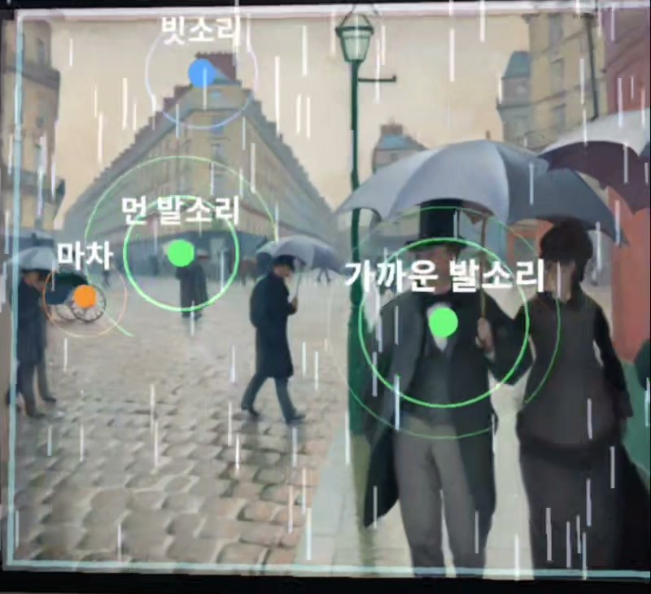

# 들리는 그림 (Hearing Paintings)

그림 속 물체가 있는 자리에서 그 물체의 소리가 들리는 AR 그림 감상 앱입니다.
폰으로 명화를 비추면 AI가 정한 소리원이 그림 속 위치와 깊이에 맞춰 3D 공간 음향으로 재생되고, 어디서 무슨 소리가 나는지 화면에 보입니다.



- **AI 파이프라인 (PC)**: 그림과 제목·작가·연도를 넣으면 로컬 AI가 소리원(이름, 유형, 위치)을 정하고, 깊이를 추정하고, 소리를 만들어 하나의 "소리 묶음"으로 묶습니다.
- **Unity 등록 (에디터)**: 소리 묶음을 앱에 자동으로 등록합니다 (인식용 이미지, 재질, 프리팹, 카탈로그).
- **AR 앱 (Android)**: 그림을 인식해 그림마다 소리 세계를 만들고, 공간 음향·음파 링·상호작용을 보여 줍니다.

대학 수업(지능형증강현실시스템) 텀 프로젝트입니다. 설계 과정과 결정 근거는 [docs/텀_아키텍처_결정사항.md](docs/텀_아키텍처_결정사항.md)에 있습니다.

---

## 목차

1. [폴더 구조](#폴더-구조)
2. [실행 환경](#실행-환경)
3. [앱 실행하기 (그림 5장이 이미 들어 있음)](#앱-실행하기)
4. [AI 파이프라인 설치](#ai-파이프라인-설치)
5. [새 그림 만들기](#새-그림-만들기)
6. [평가 다시 하기](#평가-다시-하기)
7. [앱 조작법](#앱-조작법)
8. [구조와 소리 묶음 형식](#구조와-소리-묶음-형식)
9. [알려진 한계](#알려진-한계)
10. [라이선스](#라이선스)

---

## 폴더 구조

```
hearing-painting/
├─ unity/        Unity 6 프로젝트 (AR 앱 + 에디터 등록 도구)
│  └─ Assets/
│     ├─ HearingPainting/      스크립트, 장면, 프리팹, 인식용 이미지(ReferenceImages), 글꼴
│     └─ Resources/HearingPainting/   그림별 소리 묶음 (scene.json, depth.bytes, sounds, layers)
├─ pipeline/     AI 파이프라인 (Python)
│  ├─ pipeline.py       그림 1장 → 소리 묶음 (명령 하나)
│  ├─ layers.py         그림 꺼내기용 층 PNG (가려진 곳 채우기)
│  ├─ eval_*.py         평가 스크립트
│  └─ experiments/      모델 비교 실험 스크립트 (기록용, 그대로 실행되지 않을 수 있음)
├─ paintings/    퍼블릭 도메인 그림 (평가셋 30장, 화풍별 새 그림 9장)
├─ eval/         평가 결과와 판정 기록 (발표 수치를 다시 계산할 수 있음)
└─ docs/         결정 문서, 리서치 보고서
```

**저장소는 짧은 경로에 받으세요** (예: `C:\dev\hearing-painting`). Unity 프로젝트 경로(`…\hearing-painting\unity`)가 131자를 넘으면 Android 빌드의 CMake 단계가 실패합니다(147자 경로에서 실제로 실패, 40자 경로에서 성공 확인).

`pipeline/`과 `unity/`는 서로 옆 폴더에 있어야 합니다. 파이프라인은 `../unity`에 결과를 넣고, Unity 창은 `../pipeline`을 찾습니다. 다른 곳에 두려면 환경 변수 `HP_UNITY`로 Unity 폴더를 지정하고, Unity 창에서 파이프라인 폴더를 직접 입력합니다.

## 실행 환경

확인한 환경입니다. 다른 환경은 시험하지 않았습니다.

| 항목 | 버전 |
|---|---|
| OS | Windows 10 |
| Unity | **6000.3.9f1** + Android Build Support |
| AR | AR Foundation / ARCore XR Plugin 6.3.5, URP 17.3 |
| 기기 | Galaxy S23 (ARCore 지원 Android 기기) |
| Python | 3.11 |
| GPU | NVIDIA, VRAM 12GB (RTX 3060). 모델을 단계마다 하나씩 올렸다 내려 12GB 안에서 돕니다 |

## 앱 실행하기

AI 파이프라인 없이도 됩니다. 그림 5장의 소리 묶음이 이미 들어 있습니다.

| 그림 | 소리 묶음 |
|---|---|
| 카유보트 「파리의 거리, 비 오는 날」(1877) | `Resources/HearingPainting/` |
| 브뤼헐 「눈 속의 사냥꾼」(1565) | `Resources/HearingPainting/hunters/` |
| 신윤복 「단오풍정」 | `p002/` |
| 베로 「몽마르트르 대로」 | `p003/` |
| 르누아르 「물랭 드 라 갈레트의 무도회」(1876) | `p004/` |

1. **Unity 설치**: Unity Hub → Installs → Install Editor → `6000.3.9f1` (Archive에서 찾기). 모듈에서 **Android Build Support**(OpenJDK, Android SDK & NDK 포함)를 켭니다.
2. **프로젝트 열기**: Unity Hub → Add → `unity/` 폴더. 처음 열 때 패키지를 받느라 몇 분 걸립니다.
3. **장면 열기**: Project 창에서 `Assets/HearingPainting/HearingPainting.unity`를 더블클릭합니다.
4. **에디터에서 미리 보기 (폰 없이)**: ▶ Play를 누르면 그림 5장이 카메라 앞에 뜹니다. 마우스가 손가락 역할을 합니다(길게 누르기 = 그림 꺼내기, 휠 = 깊이). Scene 창에서 시점을 돌리면 층이 펼쳐진 모습을 옆에서 볼 수 있습니다.
5. **폰에서 실행**: 폰을 USB로 연결하고 USB 디버깅을 허용합니다. **File → Build Profiles → Android → Switch Platform** 후 **Build And Run**. ARCore 설정과 빌드 장면은 이미 맞춰져 있습니다.
6. **그림 비추기**: `unity/Assets/HearingPainting/ReferenceImages/`의 jpg를 모니터에 띄우거나 인쇄해서 폰으로 비춥니다. 앱이 인식하는 이미지가 바로 이 파일들입니다.

## AI 파이프라인 설치

```bat
cd pipeline
py -3.11 -m venv .venv
.venv\Scripts\activate

:: 1) PyTorch (CUDA 11.8)
pip install torch==2.7.1 torchvision==0.22.1 torchaudio==2.7.1 --index-url https://download.pytorch.org/whl/cu118
:: 2) 나머지 패키지
pip install -r requirements.txt
:: 3) Stable Audio 3 (PyPI에 없어 git 커밋으로 고정)
pip install "stable-audio-3 @ git+https://github.com/Stability-AI/stable-audio-3@790793b89ddceea612be9ce42ff6830d18f6fa57"

:: 4) 키 설정
copy .env.example .env
```

`.env`에 넣는 값:

| 키 | 필요 여부 | 받는 법 |
|---|---|---|
| `HF_TOKEN` | **필수** | [Stable Audio 3 medium](https://huggingface.co/stabilityai/stable-audio-3-medium) 페이지에서 사용 동의 → [Hugging Face 토큰](https://huggingface.co/settings/tokens)에서 Read 토큰 발급 |
| `GEMINI_API_KEY` | 선택 | 답지 만들기·품질 채점용 ([Google AI Studio](https://aistudio.google.com/apikey)). 없으면 채점 없이 소리 묶음만 만듭니다 |

**모델은 처음 실행할 때 자동으로 내려받습니다**(Hugging Face 캐시). Qwen3.5-9B, Depth Anything 3(ONNX)·V2-Large, Stable Audio 3 medium, big-lama입니다. 수십 GB의 디스크 여유가 필요합니다(정확한 합계는 재지 않았음).

**무시해도 되는 경고**: 소리 생성 중 `No module named 'triton'`, `flash_attn not installed`가 나옵니다. Windows에는 triton이 없어 Stable Audio 3의 `torch.compile`이 일반 실행으로 바뀌는 것이고, 소리는 정상적으로 만들어집니다.

**ARCore 인식 점수**: 파이프라인은 인식용 이미지의 ARCore 점수를 `arcoreimg.exe`로 잽니다. 이 도구는 Unity가 패키지를 받을 때 `unity/Library/PackageCache/com.unity.xr.arcore@*/Tools~/Windows/`에 생기므로, **Unity로 프로젝트를 한 번 연 뒤에** 파이프라인을 돌리세요. 없으면 점수만 건너뜁니다(환경 변수 `ARCOREIMG`로 경로 지정 가능).

## 새 그림 만들기

### 방법 1: Unity 창 (권장)

1. Unity 메뉴 **Hearing Painting → 새 그림 만들기**
2. 창 위쪽의 Python 경로가 `pipeline/.venv/Scripts/python.exe`인지 확인합니다.
3. **그림 추가…** → 그림 파일을 고르고 **제목, 작가, 연도**를 적습니다. 제목과 작가를 정확히 적을수록 소리 설계가 정확해집니다. 파일 이름이 `제목_작가_연도.jpg`면 칸이 미리 채워집니다.
4. **모두 만들기**. RTX 3060에서 그림 한 장에 약 4~5분 걸리고, 끝나면 앱에 자동 등록됩니다.
5. **결과 보기**로 보고서(소리 듣기, 품질 점수, 경고)를 확인하고, 마음에 안 드는 소리는 **↻** 버튼으로 그 소리만 다시 만듭니다.

### 방법 2: 명령줄

```bat
cd pipeline
.venv\Scripts\activate
python pipeline.py 그림.jpg --key p010 --title "물랭 드 라 갈레트의 무도회" --artist "르누아르" --year 1876 --to-unity
```

그다음 Unity 메뉴 **Hearing Painting → 새 그림 등록 (Resources 훑기)**를 누르면 앱에 등록됩니다.

| 옵션 | 뜻 |
|---|---|
| `--depth auto` (기본) | DA3와 DA2-L을 함께 돌려 깊이 순서 일치도가 0.5 미만이면 DA2-L (풍경화에서 DA3가 하늘을 앞으로 내는 문제) |
| `--audio sa3m` (기본) | Stable Audio 3 medium. `sa3s`(small-sfx, 빠름), `sao1`(Stable Audio Open 1.0)도 가능 |
| `--regen <소리원 id>` 또는 `all` | 만든 그림의 소리만 새 시드로 다시 만들기 |

결과는 `pipeline/out_<key>/`에 생기고(`report.html`에서 확인), `--to-unity`면 `unity/Assets/Resources/HearingPainting/<key>/`로 복사됩니다.

**층만 다시 만들기**: 예전 그림에 그림 꺼내기용 층을 추가하려면

```bat
python layers.py ..\unity\Assets\HearingPainting\ReferenceImages\hunters.jpg out_hunters --to-unity hunters
```

### 파이프라인 단계

| 단계 | 모델 | 하는 일 |
|---|---|---|
| 1 소리 설계 | Qwen3.5-9B (4bit NF4) | 소리원 이름·유형·설명·생성 프롬프트·위치. 그림 제목·작가·연도를 참고 정보로 줌 |
| 2 답지 | Gemini (선택) | 같은 그림의 정답지를 따로 만듦 (검사용, 소리를 정하지는 않음) |
| 3 깊이 · 층 | DA3 Mono-Large / DA2-Large, big-lama | 깊이 지도(depth.bytes), 같은 소리 합치기(최대 6개), 그림 꺼내기용 층 4장(앞 층에 가려진 곳을 LaMa로 채움) |
| 4 품질 채점 | Gemini (선택) | 답지 기준 필수 소리·지어낸 소리 → 기준 미달이면 "확인 필요" |
| 5 소리 생성 | Stable Audio 3 medium | 12초 모노, 이음매 없는 반복, -28 LUFS로 음량 맞춤 (키우는 폭 +20dB 상한) |

## 평가 다시 하기

발표에 쓴 수치는 **저장된 모델 출력과 판정 기록으로 GPU·API 키 없이 다시 계산**됩니다.

```bat
cd pipeline
python eval_baseline.py qwen35_9b_nf4 --prompt v3t --score-only
```

| 지표 (평가셋 30장, 정답지 v2) | 결과 | 목표 |
|---|---|---|
| 필수 소리 찾기 | 70.7% (53/75) | 70% 이상 |
| 지어낸 소리 | 8.1% (9/111) | 15% 이하 |
| 위치 (대각선 10% 이내) | 89.3% (50/56) | — |
| JSON 성공 | 30/30 | — |
| 평균 시간 / 최대 VRAM | 31.5초 / 9.1GB | — |

- 채점은 Gemini가 그림을 보며 뜻으로 짝짓습니다. 6장을 따로 판정해 비교한 결과 자기 답에 유리한 편향은 없었고, 판정 흔들림 때문에 모든 수치에 **±5%p** 오차를 둡니다.
- 모델부터 다시 돌리려면 `--score-only`를 빼세요 (GPU, 그리고 새로 판정할 때 `GEMINI_API_KEY` 필요).
- 평가셋 밖 화풍별 9장: `python eval_newset.py score` (제목 없는 v3: 필수 78%, 지어냄 22%) / `python eval_newset.py score t` (제목을 준 v3, 지금 파이프라인과 같은 방식). 모델부터 다시 돌리려면 `run`, Gemini 답지는 `gemini`
- 정답지: `paintings/evalset/answers_claude/answers_claude_v2.json` (필수 75개, 허용 43개), `paintings/newset/answers_claude.json`

## 앱 조작법

| 동작 | 결과 |
|---|---|
| 그림 비추기 | 인식 → 깊이 격자 스캔 → 소리원 등장 |
| 소리원 탭 | 그 소리만 듣기 (솔로) |
| 소리원 끌기 | 위치 옮기기. 옆 그림에 놓으면 그 그림으로 이동 |
| 다른 소리원 위에 놓기 | 두 소리 섞기 |
| 두 손가락 | 깊이 조절 |
| 그림 길게 누르기 (1초) | 그림 속 공간 꺼내기 / 돌아가기 |
| 소리원 쪽으로 다가가기 | 강조 + 진동 |
| 오른쪽 위 "처음" 0.5초 누르기 | 처음 상태로 리셋 (짧게 탭하면 안내) |
| 세 손가락 탭 | 추적 측정 표시 (등장 시간, 떨림 mm, 튐 횟수) |
| 네 손가락 탭 | 추적 안정화 켜기·끄기 (같은 빌드에서 전후 비교) |

여러 그림 앞에서는 화면 가운데 그림의 소리만 또렷하고 나머지는 25%로 줄어듭니다(집중 모드). 조절값은 장면의 `SoundWorldManager`(PaintingSoundWorld) Inspector에 있습니다.

## 구조와 소리 묶음 형식

| Unity 클래스 | 역할 |
|---|---|
| `PaintingSoundWorld` | 매니저. 이미지 추적, 그림마다 프리팹 생성, 모든 입력, 집중 모드, 리셋 |
| `PaintingWorld` | 그림 하나의 소리 세계. 그림 기준 좌표계, 소리원 배치, 추적 안정화, 꺼내기 |
| `DepthWindow` | 깊이 메시 입체 창, 스캔 격자, 팝업 층 (미리 만든 층 PNG가 있으면 사용) |
| `SoundSource` / `SoundRing` | 3D 소리, 충돌로 섞기 / 소리 크기에서 음파 링 |
| `Editor/PaintingMakerWindow` | "새 그림 만들기" 창 (파이프라인 실행 + 자동 등록) |
| `Editor/PaintingRegistrar` | 소리 묶음 → 인식 이미지, 재질, 프리팹, 카탈로그 |

소리 묶음 (`Resources/HearingPainting/<key>/`):

| 파일 | 내용 |
|---|---|
| `scene.json` | 제목·작가·연도, 소리원 목록 `{id, label, type, u, v, depth, file, volume, prompt, …}`. `u, v`는 그림 속 비율 좌표(0~1, 왼쪽 위 0), `depth`는 0(가까움)~1(멂) |
| `depth.bytes` | 가로·세로(각 uint16) + 칸마다 먼 정도 uint8, 그림 위쪽 줄부터 (160칸) |
| `sounds/*.wav` | 소리원마다 12초 반복 소리 |
| `layers/layer0~3.png`, `layers.bytes` | 그림 꺼내기 층 (0 = 가장 가까움, 마지막 = 불투명 배경판)과 층 지도 (`depth.bytes`와 같은 구조) |

## 알려진 한계

- **추적 떨림**: 안정화 코드는 넣었지만 실기기 수치는 아직 재지 않았습니다.
- **그림 꺼내기**: 층 채우기·원근 맞춤은 에디터와 PC 투영 시뮬레이션으로만 확인했습니다. 가장 먼 층은 80% 넘게 가려져 있어 옆으로 크게 움직이면 뭉개진 곳이 보입니다.
- **소리 설계**: 우키요에처럼 학습 자료가 적은 화풍에서 잘못 읽는 경우가 있습니다(예: 날리는 종이를 연으로). 소리 이름이 어색하게 나오기도 해 `p002`, `p004`의 이름 3개는 사람이 고쳤습니다.
- **필수 소리 70.7%**는 목표 70%의 경계선입니다(±5%p).
- Windows에서만 확인했습니다 (Unity 창의 Python 경로가 `.venv/Scripts/python.exe` 기준).

## 라이선스

**코드**는 [MIT](LICENSE)입니다. 코드 외의 것은 각자의 라이선스를 따릅니다.

| 항목 | 라이선스 | 비고 |
|---|---|---|
| 그림 (`paintings/`, `ReferenceImages/`) | 퍼블릭 도메인 | 출처는 `paintings/evalset/evalset.json`, `paintings/newset/newset.json` |
| Qwen3.5-9B | Apache-2.0 | 내려받아 씀, 저장소에 없음 |
| Depth Anything 3 Mono-Large (ONNX 변환본, Jens-Duttke) | Apache-2.0 | 〃 |
| **Depth Anything V2 Large** | **CC-BY-NC-4.0 (비상업)** | 〃 `--depth auto`가 일부 그림에서 사용 |
| big-lama (LaMa) | Apache-2.0 | 〃 |
| Stable Audio 3 medium / Stable Audio Open 1.0 | Stability AI 라이선스 (사용 동의 필요) | 〃 앱에 든 소리(`sounds/*.wav`)는 이 모델들로 생성 |
| Gemini API | Google 약관 | 선택 기능 |
| Noto Sans KR | SIL Open Font License 1.1 | `Assets/HearingPainting/Fonts` |
| TextMesh Pro, Unity 패키지 | Unity 약관 | |

모델 라이선스는 2026-11 기준 Hugging Face 모델 카드에서 확인한 것입니다. 사용 전에 각 모델 페이지를 다시 확인하세요.
